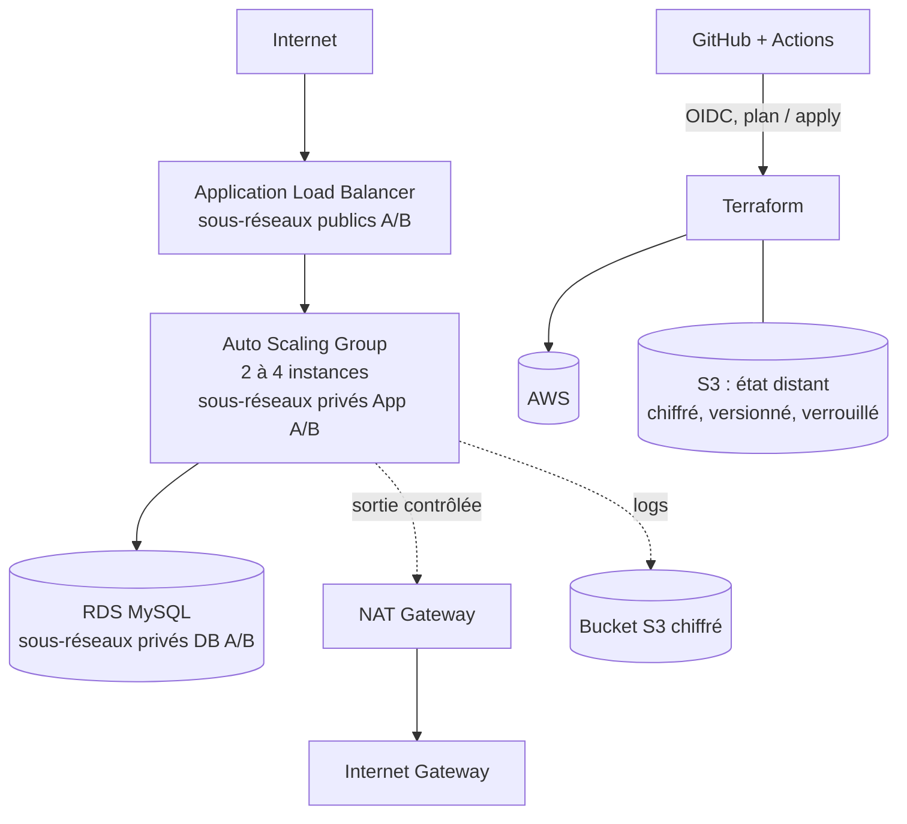

# terraform-cloud-project

Infrastructure Cloud modulaire, sécurisée et reproductible sur **AWS**, déployée avec **Terraform** et validée par un pipeline **CI/CD GitHub Actions**.

Parcours Cloud et Réseaux – Projet Terraform 5.

## 1. Description et architecture

Une application Web (nginx) est servie derrière un Application Load Balancer. Les instances applicatives et la base de données sont dans des sous-réseaux privés, répartis sur deux zones de disponibilité.



Plan réseau (VPC `10.20.0.0/16`) :

| Composant | CIDR |
|---|---|
| Public A / B | 10.20.1.0/24, 10.20.2.0/24 |
| Privé App A / B | 10.20.11.0/24, 10.20.12.0/24 |
| Privé DB A / B | 10.20.21.0/24, 10.20.22.0/24 |

Schéma d'architecture détaillé : `docs/architecture.png`.

## 2. Prérequis

- Compte AWS avec un utilisateur IAM (pas le compte root) et MFA activé
- Terraform **>= 1.10** (nécessaire pour `use_lockfile`)
- AWS CLI v2, Git
- Un dépôt GitHub

## 3. Authentification (sans secret en clair)

- **En local** : `aws configure` (les clés restent dans `~/.aws`, jamais dans Git), vérification avec `aws sts get-caller-identity`.
- **Dans le pipeline** : identité fédérée **OIDC**. GitHub assume un rôle IAM, aucune clé d'accès n'est stockée. Seuls les ARN des rôles sont enregistrés comme secrets GitHub (`AWS_PLAN_ROLE_ARN`, `AWS_APPLY_ROLE_ARN`).

## 4. Utilisation

### 4.1 Bootstrap (une seule fois)

Crée le bucket S3 de l'état Terraform et les rôles OIDC du pipeline. L'état du bootstrap reste local.

```bash
cd bootstrap
terraform init
terraform plan -out=tfplan
terraform apply tfplan
terraform output
```

Reporter le nom du bucket dans le bloc `backend "s3"` de `environments/*/providers.tf`.

### 4.2 Déployer un environnement

```bash
cd environments/dev
terraform init
terraform validate
terraform plan -input=false -out=tfplan
terraform apply tfplan
terraform output alb_url
```

### 4.3 Détruire

```bash
terraform destroy
```

Détruire dès que la démonstration est terminée (voir `docs/costs.md`).

## 5. Modules

| Module | Rôle |
|---|---|
| `network` | VPC, sous-réseaux publics/privés/DB, Internet Gateway, NAT Gateway, routage |
| `security` | Security Groups chaînés (ALB → App → DB), rôle IAM et profil d'instance (SSM, S3 limité) |
| `load-balancer` | ALB, listener HTTP, Target Group et health check |
| `compute` | Launch Template (IMDSv2, EBS chiffré, `user_data`), Auto Scaling Group, politique CPU |
| `database` | RDS MySQL privé, chiffré, mot de passe géré par Secrets Manager |
| `storage` | Bucket S3 : versioning, chiffrement, accès public bloqué, cycle de vie |

Chaque module contient `main.tf`, `variables.tf`, `outputs.tf`, `versions.tf`.

## 6. Variables et sorties principales

| Variable | Exemple | Description |
|---|---|---|
| `aws_region` | `eu-north-1` | Région de déploiement |
| `environment` | `dev` | `dev`, `test` ou `prod` |
| `project_name` | `cloud5` | Préfixe de nommage |
| `vpc_cidr` | `10.20.0.0/16` | Bloc réseau principal |
| `instance_type` | `t3.micro` | Type d'instance |
| `min_size` / `max_size` | `2` / `4` | Taille de l'Auto Scaling Group (min >= 2) |
| `db_instance_class` | `db.t3.micro` | Classe RDS |
| `single_nat_gateway` | `true` | 1 NAT (économique) ou 1 par AZ |
| `db_multi_az` | `false` | RDS Multi-AZ |

Sorties : `alb_url`, `asg_name`, `db_endpoint`, `bucket_name`, `vpc_id`.

Un exemple sans secret est fourni dans `environments/<env>/terraform.tfvars.example`.

## 7. Environnements

| Environnement | Dimensionnement | Déploiement |
|---|---|---|
| dev | minimal (1 NAT, RDS mono-AZ) | automatique après merge sur `main` |
| test | proche de prod, réduit | manuel + approbation |
| prod | NAT par AZ, RDS Multi-AZ | manuel + approbation, uniquement depuis `main` |

Chaque environnement a son propre état dans S3 (`dev/`, `test/`, `prod/terraform.tfstate`).

## 8. CI/CD

Fichier : `.github/workflows/terraform.yml`.

- **Pull Request** : `terraform fmt -check`, `init`, `validate`, `plan` pour dev, test et prod. Le plan est publié en commentaire de la PR et conservé en artefact.
- **Push sur `main`** : `apply` de **dev**.
- **Déclenchement manuel** (*Actions → Run workflow*) : `apply` de `test` ou `prod`, soumis à l'approbation d'un réviseur (GitHub Environments) et limité à la branche `main`.

## 9. Conventions

- Noms : `<projet>-<environnement>-<ressource>`
- Tags obligatoires : `Project`, `Environment`, `Owner`, `ManagedBy`
- Variables en `snake_case`, aucune valeur sensible dans `terraform.tfvars`
- Un commit = une modification cohérente

## 10. Coûts et limites connus

- Ressources payantes : NAT Gateway, ALB, EC2, RDS, adresses IPv4 publiques. Détails dans `docs/costs.md`.
- Seul le listener HTTP est configuré (pas de domaine ni de certificat ACM). HTTPS est une amélioration possible.
- Le rôle `apply` du pipeline est large (PowerUserAccess + IAM restreint au préfixe `cloud5-`) : à resserrer avec IAM Access Analyzer.
- L'état du bootstrap est local.

## 11. Dépannage

| Problème | Piste |
|---|---|
| `Not authorized to perform sts:AssumeRoleWithWebIdentity` | Vérifier les secrets GitHub (valeur = ARN seul) et le `sub` de la relation de confiance |
| Instances `Unhealthy` | Vérifier le NAT, les routes privées, et que `user_data.sh` est en fins de ligne LF |
| Erreur `releases.hashicorp.com` à `terraform init` | Coupure réseau, relancer `terraform init` |
| `bucket already exists` | Le nom du bucket doit être unique (l'ID du compte est ajouté au nom) |
| Erreur de verrou d'état | Un autre `plan`/`apply` est en cours, ou supprimer le `.tflock` obsolète dans S3 |